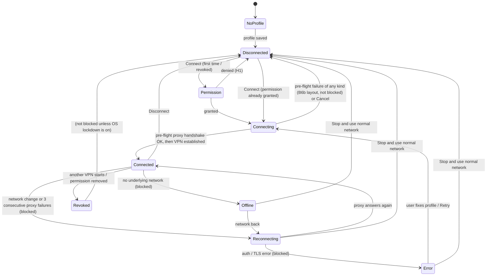

# 03 — User journeys

**Milestone:** M1 · **Status:** Draft for approval · **Screens:** board IDs refer to the design file "ProxyFlow V1 — Screens & Error States" (`design/screens/`, spec in `04-ux-screens-and-error-states.md`)

Each journey lists the trigger, the happy path, the failure branches with their error codes, and acceptance checks that M5–M10 tests must automate or demonstrate. "Blocked" always means *no packet from other apps leaves the phone except to the proxy*.

## Connection state model

Rules that apply to every state:

- **Connected** is shown only after the first successful proxy handshake, never just because the TUN interface exists.
- **Connecting** runs a pre-flight handshake with the proxy *before* the VPN interface is established. If it fails, nothing was changed on the phone: the user sees the specific error in the B6b layout ("You're not connected — apps are still using your normal network").
- Once connected, in **Reconnecting, Error and Offline** the VPN interface stays up and the engine refuses new flows → traffic is blocked (B5, B6a, B6c, B7). Leaving these states always requires an explicit user action labelled "Stop and use normal network".
- **Revoked** is outside ProxyFlow's control: Android removed the VPN. Only Always-on + "Block connections without VPN" keeps traffic blocked (`02-traffic-support-matrix.md` §4).

---

## J1 — First launch

| | |
|---|---|
| Trigger | App opened for the first time |
| Screens | A1 Welcome → A2 How it works & limits → A3 Notifications (Android 13+) → B1 Home (no profile) |
| Happy path | User reads the value proposition, sees the limits (TCP via proxy; UDP/ping/local devices blocked; provider can see sites), allows notifications, lands on Home with "Add proxy" |
| Branches | Notification permission denied → continue; Settings shows "Status notifications: Off · Turn on" (E1b; the system VPN key icon still appears). Android < 13 skips A3. |
| Acceptance | A2 is shown before the first Connect is possible; no network request is made by the app during onboarding; onboarding never shown again after completion (state in DataStore) |

## J2 — Add a profile

| | |
|---|---|
| Trigger | "Add proxy" from B1, C1, C2 FAB or B8 |
| Screens | D1 Add proxy → (D3 validation errors) → (D4 TLS-off warning) → save → C2 / B2 |
| Happy path | Protocol (SOCKS5 / HTTP), server, port, optional sign-in, optional TLS (+ SNI override under "Advanced"), optional name → Save |
| Branches | Invalid fields → D3 with inline messages (`04-ux…` §5); TLS off → inline plaintext warning (D4), emphasised when credentials are set; back with unsaved changes → D8 |
| Acceptance | Password field masked with reveal toggle; screen uses `FLAG_SECURE`; password stored only as ciphertext (ADR-0006) — verified by inspecting the app's database in an instrumentation test; name defaults to the server |

## J3 — Test a proxy

| | |
|---|---|
| Trigger | "Test proxy" in D1/D4, or "Test" in the C2 menu |
| Screens | D5 Testing (step list) → D6 passed / D7 failed |
| Happy path | Steps: reach proxy (TCP connect, RTT) → TLS verified (version, certificate subject) → sign-in accepted → one test request through the proxy → result with round-trip time |
| Branches | Each step maps to an engine code: `PROXY_DNS_FAILED`, `PROXY_UNREACHABLE`, `TLS_*`, `AUTH_REQUIRED`/`AUTH_FAILED`, `PROTOCOL_ERROR`, `HANDSHAKE_TIMEOUT`; D7 shows the failed step and the fix |
| Acceptance | The test runs without the VPN and does not change the phone's routing; credentials go only to the configured proxy; the test target (decision D6) is disclosed in the privacy policy; result saved on the profile ("Works · 182 ms · tested 2 min ago") |

## J4 — VPN permission

| | |
|---|---|
| Trigger | First Connect, or Connect after the permission was revoked |
| Screens | B9 explainer → Android system dialog → B3 Connecting, or H1 denied |
| Happy path | Explainer states: Android will ask; ProxyFlow has no servers; key icon in status bar; only one VPN can be active → system dialog → OK |
| Branches | Denied → H1 (`VPN_PERMISSION_DENIED`), nothing changed; another app is Always-on → H2 (`ALWAYS_ON_OTHER_APP`) with "Open VPN settings" |
| Acceptance | `VpnService.prepare()` result handled for grant, deny and back-press; no VPN interface created before consent; prominent disclosure shown before the system dialog (Play policy) |

## J5 — Connect

| | |
|---|---|
| Trigger | Connect on B2 (or the profile picker B8) |
| Screens | B3 Connecting (VPN permission granted → checking proxy: TLS and sign-in → starting protection) → B4 Connected; notification B10 "Connected" |
| Happy path | Foreground service starts; pre-flight handshake with the proxy succeeds; VPN interface established and engine started with the TUN fd; Home shows timer, ↑/↓, connections, protection summary |
| Branches | Credentials unreadable → H3 (`CREDENTIAL_UNREADABLE`), not connected; any pre-flight failure (`PROXY_UNREACHABLE`, `PROXY_DNS_FAILED`, `AUTH_*`, `TLS_*`, `PROTOCOL_ERROR`, `HANDSHAKE_TIMEOUT`) → B6b layout with that code's message, **not** connected, apps keep the normal network because no VPN was established |
| Acceptance | Packet capture during and after connect shows only the proxy endpoint (and its DNS lookup) on the uplink; "Connected" appears only after a successful handshake; connect time recorded in Logs |

## J6 — Reconnect

| | |
|---|---|
| Trigger | Wi-Fi ↔ mobile switch, proxy outage, device sleep/wake |
| Screens | B5 Reconnecting (attempt n, next try, "Retry now", "Edit profile") → B4; B7 Offline when there is no network; notification "Reconnecting… traffic paused" |
| Happy path | Underlying network change detected (`ConnectivityManager` callback) → `setUnderlyingNetworks` updated → in-flight flows closed → new flows dial via the new network → Connected |
| Branches | Proxy keeps failing → exponential back-off (1, 2, 4, 8, 16, 30 s cap, with jitter); auth/TLS failure during reconnect → Error (B6a/B6c); no network → B7 (`OFFLINE`) |
| Acceptance | During the whole reconnect window the uplink capture shows no direct packets (E10 is the lab equivalent); recovery happens without restarting the engine (E10); counters and timer continue for the session |

## J7 — Disconnect

| | |
|---|---|
| Trigger | Disconnect on B4, the notification action, the Quick Settings tile (B11, built in M9), or "Stop and use normal network" from a blocked state |
| Screens | B2 Disconnected ("Apps are using your normal network") |
| Happy path | Engine stopped (all flows closed, goroutines released — E12), TUN fd closed, foreground service stopped, notification removed |
| Branches | If OS lockdown is on, apps have no network after disconnect — B2 says so and links to E2 |
| Acceptance | Stop completes in < 2 s with 200 open flows and apps see their connections end at once (lab E12: `Stop()` took 24 ms with 200 flows open, goroutines 608 → 2, and the last app saw its connection end 17 ms after the stop signal); no leaked file descriptors (instrumentation check on devices); session summary written to Logs |

## J8 — Error recovery

| Situation | Screen | User action | Result |
|---|---|---|---|
| Wrong username/password while connected (`AUTH_FAILED`) | B6a (blocked), notification "Traffic blocked: sign-in failed", F3 detail | Edit credentials → D7 test → Save | Reconnects; or "Stop and use normal network" |
| Untrusted / expired / mismatched certificate while connected (`TLS_*`) | B6c with certificate subject, issuer, SHA-256 | Edit profile (fix server name), contact provider; no "trust anyway" in V1 | Reconnects only with a valid certificate |
| Any proxy-level error during the pre-flight check | B6b layout with the code's message (not blocked) | Try again / Edit profile / Use another proxy | Nothing changed on the phone |
| Proxy unreachable at connect (`PROXY_UNREACHABLE`) | B6b (not blocked) | Try again / Edit / Use another proxy | — |
| Proxy dies while connected | B5 (blocked) | Wait / Retry now / Stop | Auto-recovers (E10) |
| One site refused by the proxy (`TARGET_*`) | Logs only (F2) | — | Tunnel stays up (E03) |
| VPN revoked by Android or another VPN (`VPN_REVOKED`) | B6d (not blocked) | Reconnect; "Set up system kill switch" → E2 | — |
| Saved password unreadable (`CREDENTIAL_UNREADABLE`) | H3 | Re-enter password | — |

Acceptance: every engine code in `spike/engine/adapters/errors.go` has a designed presentation (ErrorCatalogue board); the escalation rule (3 consecutive proxy-level failures, or one auth/TLS failure) is unit-tested in M7.

## J9 — Set up the system kill switch

| | |
|---|---|
| Trigger | Banner on B2, Settings E1 "System kill switch · Off · Set up", or B6d |
| Screens | E2 guide → Android VPN settings (`Settings.ACTION_VPN_SETTINGS`) → E1b (status "On") |
| Acceptance | On API 29+ the status reads from `VpnService.isAlwaysOn()` / `isLockdownEnabled()` while running; on older versions (if minSdk 26) the status shows "Unknown — check Android settings"; tested on at least two OEM skins (menu names vary) |

## J10 — Logs and diagnostics

| | |
|---|---|
| Trigger | Logs tab, "Details" from an error |
| Screens | F1 empty → F2 list (filters: All, Errors, Connection, Blocked) → F3 entry detail |
| Acceptance | No credentials, payload or (by default) destinations in any log, export or notification (E14 is the engine-level check; M7 repeats it for the app database and logcat); retention purge runs daily; "Copy" produces redacted text |

## J11 — Change profiles while connected

| | |
|---|---|
| Trigger | Pick another profile in B8, or edit/delete the active profile |
| Behaviour | Switching closes existing flows and reconnects with the new profile (brief Reconnecting state, blocked); editing the active profile asks "Reconnect with changes?" (D9); deleting it reads "Disconnect and delete" (C3) |
| Acceptance | No window in which traffic goes direct while switching (packet capture) |
