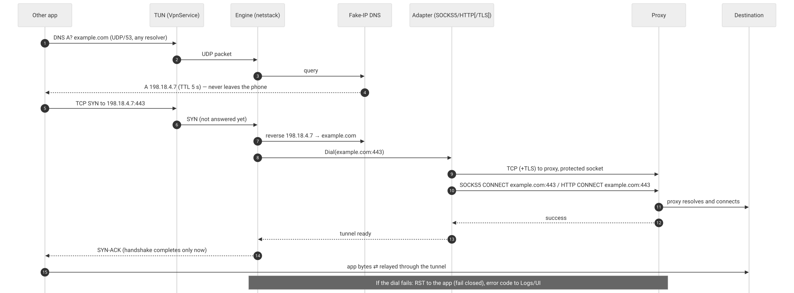
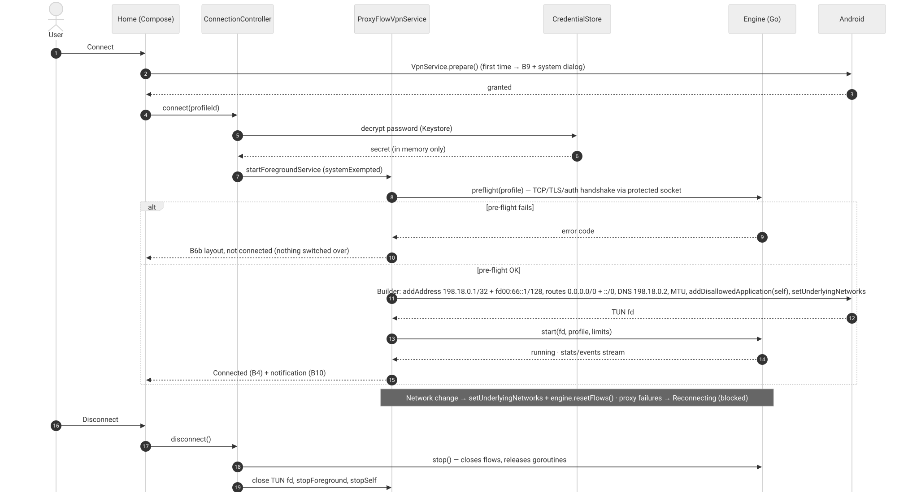

# 06 — Architecture

**Milestone:** M1 · **Status:** Proposed — needs approval of the networking approach (D1) before implementation starts · **Diagrams:** `docs/diagrams/*.mmd` (Mermaid source) and `*.svg` (rendered)

## 1. Drivers

| Driver | Consequence |
|---|---|
| Brief: separate UI, data, VPN service, packet engine and protocol adapters | Five Gradle modules with one-way dependencies (§2) |
| Brief: maintained, audited TUN/TCP engine; no TCP stack from scratch | gVisor netstack (ADR-0001) |
| Fail closed, never bypass | Dial-before-accept, no fallback paths, app excluded from its own VPN only for proxy traffic (ADR-0002/0004) |
| No credentials or payload in logs | Typed events with no payload fields; redaction at the source (E14) |
| HTTP CONNECT, SOCKS5, optional TLS-to-proxy | In-process adapters in the engine, no local proxy listener (ADR-0002) |
| Play VpnService policy | TLS-to-proxy first-class; build flag for "TLS required" (ADR-0005) |

## 2. Modules



| Module | Responsibility | May depend on |
|---|---|---|
| `:app` | Activity, navigation, DI wiring, theme | all feature modules, `:core:ui` |
| `:feature:home`, `:feature:profiles`, `:feature:logs`, `:feature:settings` | Compose screens + ViewModels for each tab | `:core:ui`, `:core:model`, `:core:data`, `:vpn` (controller interface only) |
| `:core:ui` | Theme generated from design tokens, shared components (status ring, profile card, error banner) | `:core:model` |
| `:core:model` | Pure Kotlin types: `Profile`, `ProxyProtocol`, `ConnectionState`, `ErrorCode` (mirrors `adapters/errors.go`) | — |
| `:core:data` | Room (profiles, log events), DataStore (settings), `CredentialStore` (Keystore AES-GCM, ADR-0006), log retention worker | `:core:model` |
| `:vpn` | `ProxyFlowVpnService` (foreground service), `ConnectionController` state machine, `NetworkMonitor`, lockdown status, notifications, Quick Settings tile | `:core:model`, `:core:data`, `:engine-api` |
| `:engine-api` | Kotlin interface the VPN layer talks to; a fake implementation for UI and service tests | `:core:model` |
| `:engine` | Go library (gVisor netstack + fake-IP DNS + adapters) packaged as an AAR with `gomobile bind`; thin Kotlin adapter implementing `:engine-api` | `:engine-api` |

Rules: UI never talks to the engine directly; decrypted credentials pass only from `:core:data` through `:vpn` into `:engine`, which keeps them in memory for the connected session (every new app connection signs in to the proxy) and clears them on stop; `:engine` has no Android dependencies except the callbacks it is given.

## 3. Packet path



1. Android routes every app's IPv4 and IPv6 packets to the TUN interface (`0.0.0.0/0`, `::/0`), except ProxyFlow's own (`addDisallowedApplication(self)`).
2. The engine reads packets from the TUN fd into gVisor netstack (fdbased link endpoint, promiscuous + spoofing so it can terminate connections to any address).
3. **DNS** (UDP/53 to any address) is answered by the fake-IP responder: `A` → an address from `198.18.0.0/15` (first 256 reserved: TUN `198.18.0.1`, DNS `198.18.0.2`), TTL 5 s; `AAAA`/`HTTPS`/`SVCB` → no data; others → refused (ADR-0003).
4. **TCP SYN** → `tcp.Forwarder` callback. The engine maps a fake IP back to its hostname, checks the connection limit, then **dials the proxy first**. Only when the proxy tunnel is established does it complete the app's handshake (SYN-ACK). Any failure → RST to the app, error code to stats/events. This is what makes it fail closed (E10: 0.011 s refusal when the proxy's port is closed, no direct packets).
5. Bytes are relayed both ways with half-close and a shared idle timeout (5 min).
6. **Other UDP** → rejected with ICMP port-unreachable (apps fall back from QUIC to TCP); **ICMP echo** → an echo filter between the TUN and the stack drops echo requests and every fragment of an ICMP packet on the way in, and discards any echo reply or ICMP fragment on the way out, so pings — large, fragmented ones included — are never answered (ADR-0004; gVisor itself would answer IPv6 pings for any address in promiscuous mode).

## 4. Connect sequence



- **Pre-flight first.** Before `Builder.establish()`, the service performs one proxy handshake (TCP, TLS, auth) using the same engine adapters. A failure leaves the phone's network untouched (B6b layout).
- **Builder configuration (V1):** `addAddress(198.18.0.1, 32)`, `addAddress(fd00:66::1, 128)`, `addRoute(0.0.0.0, 0)`, `addRoute(::, 0)`, `addDnsServer(198.18.0.2)`, `setMtu(9000)` (E13: 3.2× upload and 4.8× download vs MTU 1500 for this engine; validated on devices in M10 with 1500 as fallback), `addDisallowedApplication(packageName)`, `setUnderlyingNetworks(activeNetwork)`, `setMetered(...)` mirrored from the underlying network, `setBlocking(false)`. **Never** `allowBypass()`.
- **Foreground service** type `systemExempted` with `FOREGROUND_SERVICE_SYSTEM_EXEMPTED` (eligible: VPN apps configured in Android's VPN settings); fallback `specialUse` if a device rejects it (verified in M5) — ADR-0007.

## 5. Engine (from the spike, to be productised in M4)

| Concern | Design | Spike reference |
|---|---|---|
| Stack | gVisor `pkg/tcpip`: IPv4, IPv6, TCP, UDP; no ICMP transport registered; `echoFilter` link wrapper drops echo requests and ICMP fragments in, echo replies and ICMP fragments out | `engine/engine.go`, `engine/echofilter.go` |
| Limits | `MaxConns` 1024 concurrent flows, `MaxInFlight` 512 pending handshakes, `DialTimeout` 15 s for the whole tunnel set-up (proxy connect and proxy handshake 10 s each), `IdleTimeout` 5 min, DNS flow idle 2 s; TCP buffer size configurable | `engine.Config` |
| Isolation | Per-flow panic recovery (counted, reported as `INTERNAL`); the engine keeps running | `engine/tcp.go` |
| Cleanup | `Stop()` closes every tracked flow, waits for goroutines, idempotent; does **not** close the TUN fd (owned by Kotlin) | E12: `Stop()` with 200 flows open took 24 ms; goroutines 608 → 2; the last app saw its connection end 17 ms after the stop signal |
| Adapters | SOCKS5 (RFC 1928/1929), HTTP CONNECT (Basic, preemptive), TLS wrapper (TLS 1.2+, strict verification, SNI override); hostname validation blocks header injection; response headers capped (16 KiB / 100 lines) | `adapters/` + fuzz targets |
| Errors | 19 stable codes shared with the UI (`adapters/errors.go`); proxy-level vs target-level | `04-ux…` §4 |
| Observability | Stats snapshot (bytes, active/opened/failed flows, DNS outcomes, UDP rejected, RSS, goroutines, last proxy error, consecutive failures) + typed event stream; destinations only when the user enables "Record destinations" | E14 |

### Kotlin ⇄ Go boundary (gomobile)

```go
// package pfengine — exported to Kotlin by gomobile bind
type Platform interface {            // implemented in Kotlin
    Protect(fd int64) bool                        // VpnService.protect, belt-and-braces with app exclusion
    ResolveProxyHost(host string) (string, error) // via the underlying Network.getAllByName (E16)
    VerifyChain(derChain []byte, host string) string // "" = trusted; else error code (ADR-0005)
    OnEvent(json string)                          // redacted events → Logs
}
func Start(tunFD int64, profileJSON string, secret []byte, p Platform) error
func Stop()
func Stats() string // JSON snapshot for the UI (polled ~1 s while visible)
func ResetFlows()   // after an underlying-network change
```

- The proxy hostname is resolved by Android on the **underlying network** (Go's pure resolver has no `/etc/resolv.conf` on Android); the resolved address is dialled through a protected socket. Only the proxy hostname is ever resolved outside the tunnel (E16).
- TLS certificate validation calls back into Android's platform `X509TrustManager` (system CAs only, honours platform distrust and network security config) rather than Go's own root loading, which on Android reads user-installed CAs and misses the updatable Conscrypt store (ADR-0005).
- The secret crosses the boundary once per start as bytes, never in JSON or logs. Because every new app connection authenticates to the proxy (SOCKS5 RFC 1929 or HTTP Basic), the engine must keep it for the whole session: it is held in a `[]byte` (not a Go `string`, which cannot be wiped), never logged or written to disk, and zeroed in `Stop()`; Kotlin zeroes its `CharArray` copy after `Start()`. Residual: a memory dump of the running process on a compromised device could reveal it (threat model I-12). The spike's adapters still use a `string`; M4 changes that.

## 6. Android integration details

| Topic | Decision |
|---|---|
| Underlying network changes | `NetworkCallback` on the default network → `setUnderlyingNetworks`, `ResetFlows()`; state → Reconnecting until the next successful proxy handshake |
| Doze / app standby | VPN foreground service is exempt from most restrictions; keep-alives on proxy sockets 30 s idle; verify battery in M10 |
| Process death | If Android kills the process, the TUN closes and traffic goes direct **unless** lockdown is on — the reason E2 guides users to Always-on + "Block connections without VPN" (E11) |
| Always-on start | Service handles `SERVICE_INTERFACE` start without UI: loads the last active profile; if credentials are unreadable it stays blocked (lockdown) and posts the H3 notification |
| Lockdown detection | `isAlwaysOn()` / `isLockdownEnabled()` (API 29+) shown in Settings E1 |
| Notifications | Two channels: "Connection status" (low importance, ongoing) and "Connection problems" (high importance, alerts once per incident) — B10 |
| Backups | `allowBackup=false` and data-extraction rules that exclude everything: Keystore keys are not backed up, so restored ciphertext would be unreadable (and credentials should not leave the phone in backups) |
| Screen capture | `FLAG_SECURE` on Add/Edit and any screen showing credentials |

## 7. Data

| Store | Contents | Notes |
|---|---|---|
| Room `profiles` | id, name, protocol, host, port, tls, sni, `credentials_ct` (username and password together), `credentials_iv`, `key_version`, last test result/time, order | credentials only as AES-GCM ciphertext; AAD = profile id; the username is decrypted for display on the edit screen |
| Room `log_events` | time, level, code, profile id, message key, redacted details, destination (only if enabled) | purged by retention (default 24 h) |
| DataStore | onboarding done, active profile, retention, record-destinations, theme, auto-reconnect | no secrets |
| Keystore | one AES-256-GCM key, non-exportable, no user-authentication requirement (reconnect must work while locked) | ADR-0006 |

## 8. Build and supply chain

- Go toolchain pinned (spike: Go 1.27.3); `go.sum` committed, and CI rebuilds it from `proxy.golang.org` with every hash checked against `sum.golang.org`, failing on any difference (`go mod verify` then checks the module cache); gVisor pinned to a commit on its `go` branch (spike: `v0.0.0-20261029062900-94fcb330700e`).
- `gomobile bind` produces the AAR for arm64-v8a, armeabi-v7a, x86_64 (x86 optional); the NDK version is pinned in Gradle.
- Size: the spike's android/arm64 binary is 8.6 MiB stripped (`binary-sizes.txt` in the final evidence run); the AAR's per-ABI `.so` will be similar. App Bundles deliver one ABI per device.
- Dependencies are reviewed per milestone (`08-dependency-review.md`); licences collected for the in-app notices (G1).

## 9. What the spike proved and what remains

Proved in the lab: the packet path, all adapters against real servers (Dante, Squid, stunnel), fake-IP DNS, UDP/ICMP policy, fail-closed outage handling, cleanup and resource behaviour (`09-feasibility-report.md`).

Remaining, by milestone: gomobile packaging and on-device `VpnService` run (M4/M5 — Android SDK/NDK was not reachable from the M1 environment); Kotlin trust-manager callback (M6); lockdown and revocation behaviour on real devices (M8); performance on phones (M10).
