# 07 — Threat model

**Milestone:** M1 · **Status:** Draft for security review · **Method:** STRIDE per data-flow element · **Diagram:** `docs/diagrams/threat-model-dfd.svg`

## 1. Scope and assumptions

In scope: the ProxyFlow app (UI, data, VPN service, engine, adapters), its stored data, and the path from other apps on the phone to the user's proxy. Out of scope: a rooted or already-compromised device, the proxy provider's infrastructure, destination servers' security, and hiding the fact that a VPN is in use.

Assumptions: Android's app sandbox, Keystore and `VpnService` behave as documented; the user chooses the proxy and can trust it as much as they trust its operator; other apps on the phone may be malicious but have no root.

## 2. Assets

| ID | Asset | Why it matters |
|---|---|---|
| A1 | Proxy username/password | Paid account; reuse elsewhere |
| A2 | Destination names (DNS, SNI, CONNECT targets) and non-TLS payload | Browsing history, content |
| A3 | The user's real IP address / location | Usually the reason to use a proxy |
| A4 | Routing integrity: traffic goes through the proxy or nowhere | Core promise ("fail closed") |
| A5 | Local logs and statistics | May contain destinations if the user enables them |
| A6 | Connectivity (availability) | A blocked phone is a failure too |
| A7 | Integrity of the shipped app and its dependencies | Supply chain |

## 3. Adversaries

| ID | Adversary | Capabilities |
|---|---|---|
| T1 | Local network / ISP (public Wi-Fi, hostile router) | Passive sniffing; active man-in-the-middle; blocking |
| T2 | Malicious or compromised proxy | Sees all CONNECT targets and non-TLS payload; sends malformed protocol responses |
| T3 | Malicious app on the same phone (no root) | Scans localhost ports, sends arbitrary packets into the VPN, floods connections, reads world-readable files, draws overlays |
| T4 | Malicious destination | Sends arbitrary bytes back through the tunnel |
| T5 | Person with the phone, backups, or a cloud restore | Reads app data at rest |
| T6 | Supply-chain attacker | Tampered dependency, toolchain or build |

## 4. Threats and mitigations (STRIDE)

| ID | STRIDE | Threat | Mitigation in design | Verification |
|---|---|---|---|---|
| S1 | Spoofing | T1 impersonates a TLS-enabled proxy | TLS 1.2+, chain validated against **system** CAs via the platform trust manager, hostname/SNI checked, no "trust anyway", no silent downgrade to plaintext | E04: expired, wrong host, unknown issuer, plaintext port all fail closed; M6 repeats on device with the platform trust manager |
| S2 | Spoofing | T1 impersonates a **plaintext** proxy | None possible at protocol level; plaintext warning on the profile; Play-build decision D2 | E05 documents the exposure |
| S3 | Spoofing | T3 talks to a local proxy port pretending to be a client (detectors such as RKNHardering on F-Droid already scan localhost for open SOCKS5/HTTP ports) | **No loopback listener**: adapters run in-process (ADR-0002) | **M5:** `VpnEndToEndTest.nothingListensWhileConnected` — while connected, the app owns no listening TCP socket and no UDP socket (`/proc/net/{tcp,tcp6,udp,udp6}`), on API 29–36 emulators |
| S4 | Spoofing | T3 overlays the VPN consent or Connect UI (tapjacking) | System consent dialog is Android's; `filterTouchesWhenObscured` on Connect/Delete/credential fields | M9 UI test |
| T-1 | Tampering | T2/T1 modify plaintext traffic | TLS-to-proxy; most apps also use end-to-end TLS, which ProxyFlow relays unchanged | **M6 on devices:** `httpsToASiteStaysEndToEnd`: the shell's TLS client sees the site's own certificate through both a plain and a TLS proxy |
| T-2 | Tampering | T2 sends malformed SOCKS5/HTTP replies to break the parser | Bounded parsers (16 KiB / 100 header lines, SOCKS5 length checks), Go memory safety, fuzz targets `FuzzReadSOCKS5Reply`, `FuzzReadConnectResponse` | M1: 30 s per target, no crashes; CI fuzzing from M4 |
| T-3 | Tampering | T3 injects crafted packets into the TUN to crash the stack | gVisor netstack (hardened, in Google's attacker model for remote packets); per-flow panic recovery in our handlers | E12 stress; M10 adds packet fuzzing at the TUN; residual R4 |
| T-4 | Tampering | T3/T5 edits stored profiles or ciphertext | AES-GCM with the profile id as associated data; app-private storage | M3 unit tests |
| T-5 | Tampering | Hostname from a DNS query used to inject headers into `CONNECT` | Strict hostname validation in DNS responder and adapters (LDH + `_`, ≤ 253) | `TestResponderRejectsInjectionNames`, `TestHTTPConnectRejectsInjectedHostname` |
| R-1 | Repudiation | — | Single-user local app with no server: not applicable. Logs are diagnostics, not an audit trail | — |
| I-1 | Info disclosure | T1 reads credentials/destinations of plaintext profiles | TLS-to-proxy option; inline warning; D2; copy tells TLS to the proxy apart from HTTPS (M6, ADR-0011) | E05 vs E04; **M6 on devices:** HTTP CONNECT and SOCKS5 over TLS through stunnel with the run's CA; wrong name, expired, untrusted CA and no TLS never connect; every connection to a TLS port in the captures opens with a TLS record; a certificate swapped while connected is refused per connection |
| I-2 | Info disclosure | T5 reads credentials at rest | Keystore-backed AES-256-GCM, no plaintext fallback, `allowBackup=false` + extraction rules, `FLAG_SECURE` | M3 tests + manual adb backup check |
| I-3 | Info disclosure | Credentials or payload in logs, logcat, notifications, crash output, clipboard | Typed events with no payload fields; redaction at source; release builds strip debug logging; no third-party crash/analytics SDKs; "Copy" exports redacted text only | E14 (engine); M7 repeats for DB/logcat/notifications |
| I-4 | Info disclosure | DNS leak to the ISP resolver | All UDP/53 and (M6, ADR-0011) TCP/53 captured and answered locally; only the proxy's own hostname is resolved outside (via the underlying network) | E07 (no port-53 packets on uplink), E16; **M6 on devices:** `RoutingEndToEndTest` asks the VPN's, the uplink's and a public resolver over UDP and TCP and gets ProxyFlow's placeholder from each; `scripts/m6_evidence.py` checks the phone's uplink DNS server (the lab's, logging) was never asked for a lab name, the proxies' DNS server resolved them, and the captures show no DNS query for them; while ProxyFlow was connected (each capture lined up with logcat by the phone's own connections to its proxy; one that cannot be lined up fails the run), any lookup or new connection on the uplink other than the proxy's, its own name's lookup and Android's network checks and time fails the run, also while the proxy failed |
| I-5 | Info disclosure | Real-IP leak during proxy outage, reconnect or profile switch | Dial-before-accept; no fallback dial; state machine keeps TUN up while blocked | E10 (RST in 0.011 s when the proxy port is closed; a silent proxy is refused after the 10 s connect timeout; nothing direct); **M5:** "Connected" only once Android routes apps into the interface (ADR-0010 §3); one interface per connection, so a switch or a restart never opens the gap Android leaves between bringing an old interface down and routing a new one (§5); `VpnEndToEndTest` sends lines to a sink beside the destination, which nothing else uses, while a switch to a silent proxy is under way, after it failed (Blocked) and while an engine failure holds traffic, and `scripts/m5_evidence.py` checks the sink logged no connection and no proxy was asked for it (so a held packet replayed later would show too), the destination saw only proxied connections, and the captures of the phone's uplink show no packet to either and no DNS query for the destination's name; M8 on devices |
| I-6 | Info disclosure | Leak when the VPN itself goes away (crash, process death, revoked) | Only Android lockdown prevents this; app detects lockdown status (API 29+) and guides setup (E2) | E11 A/B/C; M8 on devices |
| I-7 | Info disclosure | IPv6 leak around an IPv4-only tunnel | `::/0` routed into the TUN; IPv6 TCP proxied by address; IPv6 UDP rejected | Unit `TestIPv6*`; **M6 on devices:** TCP to an IPv6 address and to an IPv6-only name through both proxies, UDP over IPv6 refused, `ping6` unanswered, no packet to the IPv6 destination in the captures (IPv6 extension headers walked; each run records whether the uplink had IPv6 at all) |
| I-8 | Info disclosure | WebRTC/STUN reveals the public IP | Non-DNS UDP is rejected inside the tunnel | E08 (zero UDP on uplink); **M6 on devices:** "port unreachable" for IPv4 and IPv6 UDP, the lab's UDP sinks received nothing |
| I-9 | Info disclosure | Destinations stored in logs | "Record destinations" off by default; 24 h retention; local only | E14 |
| I-10 | Info disclosure | T2 sees every destination | Inherent to using a proxy; disclosed in onboarding (A2) and About (G1) | Copy review |
| I-11 | Info disclosure | Profile name on the lock screen | Notification `VISIBILITY_PRIVATE` with a public version without profile name (M5); the VPN's session name in Android's settings is the app's, never a profile's | **M5:** the device test checks the status notification's visibility and that its public version names no profile |
| I-12 | Info disclosure | Proxy credentials held in memory for the whole connected session (each new connection signs in to the proxy) | Kept only in the engine as a `[]byte`, never serialised, logged or written to disk, zeroed on stop; the Android sandbox keeps other apps out of the process | M4 code review + unit test that `Stop()` clears it; memory dumps on rooted devices are out of scope |
| I-13 | Info disclosure / integrity of diagnostics | The tunnel answers pings itself, so a dead proxy or unreachable host looks reachable | Echo filter: echo requests and every fragment of an ICMP packet dropped before the stack (IPv6 extension headers walked); echo replies and ICMP fragments discarded on the way out | E09 (kernel and raw pings, small and 2 KB fragmented, IPv4 and IPv6: zero replies), `TestPingIsNeverAnswered`, `TestEchoFilterBlocksOutboundReplies`; found by the two M1 reviews (plain IPv6 pings, then large fragmented ones) and fixed |
| D-1 | DoS | T3 opens thousands of connections | `MaxConns` 1024 → `CONNECTION_LIMIT` (the app gets a RST); beyond `MaxInFlight` 512 pending handshakes gVisor drops new SYNs, so apps retry; per-flow idle timeout | E12 (200 flows); M10 load test at the limits |
| D-2 | DoS / Tampering | T3 churns unique names to exhaust memory, or to force an address to be recycled while another app still holds it (its next connection would go to the wrong hostname) | LRU pool over 198.18.0.0/15 (~131 k addresses), unmapped addresses refused (`STALE_DNS_MAPPING`). Production adds a minimum reuse delay (proposal: 10 min since last use; allocation fails closed when nothing is free) and a memory bound on the name table. **M4:** in place — an address is reassigned only after 10 min without answers, new connections or open connections (open connections pin it); freed addresses queue behind all others; at most 16 384 names (3.9–7.6 MiB, freed-address queue included); `SERVFAIL` when every mapping is in use or recent; one pool per app process, random start. Residual risk: one app keeping 16 384 names fresh (≈ 27 lookups/s) makes new names fail for every app while it does — chosen over misrouting; counted as `exhausted` | `TestPoolNeverReusesARecentAddress`, `TestPoolNeverReassignsAnAddressWithAConnectionOpen`, `TestPoolFreedAddressesQueueOldestFirst`, `TestOpenConnectionPinsItsFakeAddress`, `TestResponderAnswersServfailWhenExhausted` (M4); memory on devices in M10 |
| D-3 | DoS | T2 stalls handshakes | Proxy connect and handshake 10 s each, whole tunnel set-up 15 s, header caps, idle timeouts | `TestProxyUnreachableAndTimeout` |
| D-4 | DoS | Memory pressure on low-end phones | Pooled 32 KiB relay buffers; configurable TCP buffers; limits tuned on devices. **M4:** netstack TCP buffers 64 KiB, at most 128 KiB per direction, never auto-tuned (gVisor default 1 MiB growing to 4 MiB); a stalled upload holds 93 KiB | E12/E13 (VM); `TestStalledFlowsHoldLittleMemory` (M4); M10 on devices |
| E-1 | Elevation | T3 abuses exported components | Only the launcher activity and the tile service (`BIND_QUICK_SETTINGS_TILE`, M9) are exported; no content providers. The VPN service is not exported at all and requires `BIND_VPN_SERVICE` (only Android binds it; M5) | M2 manifest lint + test; M5 `ManifestTest` and `check_release_manifest.py` check the VPN service's declaration |
| E-2 | Elevation | Memory corruption in the engine | Go memory safety; no C networking code; `unsafe` limited to gVisor internals | Dependency review; fuzzing |
| E-3 | Elevation / T6 | Tampered dependency or toolchain | Pinned versions, `go.sum` + `go mod verify`, Gradle dependency verification metadata, Play App Signing, licence and advisory review per release | `08-dependency-review.md`; CI |

A recent example of why TLS settings must be enforced on every code path: CVE-2026-9697 in Node's undici HTTP client dropped TLS options on its SOCKS5 path ([CERT.hr](https://cve.cert.hr/cve/CVE-2026-9697)). ProxyFlow's E04 covers TLS on both SOCKS5 and HTTP CONNECT; M6 adds a test that every TLS-enabled profile type refuses a plaintext proxy.

## 5. Residual risks (accepted for V1 unless the owner decides otherwise)

| ID | Risk | Why accepted | User-facing handling |
|---|---|---|---|
| R1 | Without Android lockdown, traffic goes direct when the VPN stops (crash, process death, another VPN, user disconnect) | Platform behaviour; only the OS can block | Settings and Home banner until lockdown is on (E2, B2) |
| R2 | Plaintext proxy profiles expose credentials and destinations on the local network | Most consumer proxies offer no TLS; blocking them would make the app unusable for most users | Inline warning (D4); owner decision D2 for the Play build |
| R3 | The proxy operator sees destinations and unencrypted payload | Inherent to proxies | Onboarding A2 and About G1 |
| R4 | A netstack bug triggered by crafted packets could crash the engine process | Mature upstream, fuzzing, quick updates | Falls back to R1 behaviour; Always-on restarts the service |
| R5 | Some Android system traffic is never routed through any VPN (validation probes, carrier services) and tethered/work-profile traffic is not covered | Platform behaviour | Traffic matrix §3; never claim "all traffic" |
| R6 | Apps and networks can tell a VPN is in use (`TRANSPORT_VPN`, proxy SNI, proxy IP reputation) | Not a V1 goal | Not claimed |

## 6. Security requirements carried into later milestones

1. No code path may connect to a destination except through the active profile's adapter (M4 code review checklist item).
2. The engine never answers ICMP echo for any address family or packet size, fragmented requests included (E09, `TestPingIsNeverAnswered` and `TestEchoFilterBlocksOutboundReplies` stay in CI).
3. Release builds fail CI if any log statement includes profile secrets or payload buffers (lint rule, M7).
4. The engine's TLS verification must call the platform trust manager; Go's root loading is disabled in production builds (M6).
5. Lockdown, revocation and process-death behaviour verified with packet capture on at least three devices (M8).
6. Fuzzing of adapters and the DNS responder runs in CI; any crash blocks release (M10).
7. Security review of this model with the implementation before M11 ("Do not publish until critical security and routing tests pass").
