# 07 — Threat model

**Milestone:** M1 · **Status:** Reviewed in M8 (`docs/m8/security-review.md`); updated with each milestone · **Method:** STRIDE per data-flow element · **Diagram:** `docs/diagrams/threat-model-dfd.svg`

## 1. Scope and assumptions

In scope: the ProxyFlow app (UI, data, VPN service, engine, adapters), its stored data, and the path from other apps on the phone to the user's proxy. Out of scope: a rooted or already-compromised device, the proxy provider's infrastructure, destination servers' security, and hiding the fact that a VPN is in use.

Assumptions: Android's app sandbox, Keystore and `VpnService` behave as documented; the user chooses the proxy and can trust it as much as they trust its operator; other apps on the phone may be malicious but have no root.

## 2. Assets

| ID | Asset | Why it matters |
|---|---|---|
| A1 | Proxy username/password | Paid account; reuse elsewhere |
| A2 | Destination names (DNS, SNI, CONNECT targets) and non-TLS payload | Browsing history, content |
| A3 | The user's real IP address / location | Usually the reason to use a proxy |
| A4 | Routing integrity: traffic goes through the proxy or nowhere | Core promise ("fail closed") |
| A5 | Local logs and statistics | May contain destinations if the user enables them |
| A6 | Connectivity (availability) | A blocked phone is a failure too |
| A7 | Integrity of the shipped app and its dependencies | Supply chain |

## 3. Adversaries

| ID | Adversary | Capabilities |
|---|---|---|
| T1 | Local network / ISP (public Wi-Fi, hostile router) | Passive sniffing; active man-in-the-middle; blocking |
| T2 | Malicious or compromised proxy | Sees all CONNECT targets and non-TLS payload; sends malformed protocol responses |
| T3 | Malicious app on the same phone (no root) | Scans localhost ports, sends arbitrary packets into the VPN, floods connections, reads world-readable files, draws overlays |
| T4 | Malicious destination | Sends arbitrary bytes back through the tunnel |
| T5 | Person with the phone, backups, or a cloud restore | Reads app data at rest |
| T6 | Supply-chain attacker | Tampered dependency, toolchain or build |

## 4. Threats and mitigations (STRIDE)

| ID | STRIDE | Threat | Mitigation in design | Verification |
|---|---|---|---|---|
| S1 | Spoofing | T1 impersonates a TLS-enabled proxy | TLS 1.2+, chain validated against **system** CAs via the platform trust manager, hostname/SNI checked, no "trust anyway", no silent downgrade to plaintext | E04: expired, wrong host, unknown issuer, plaintext port all fail closed; M6 repeats on device with the platform trust manager |
| S2 | Spoofing | T1 impersonates a **plaintext** proxy | None possible at protocol level; plaintext warning on the profile; Play-build decision D2 | E05 documents the exposure |
| S3 | Spoofing | T3 talks to a local proxy port pretending to be a client (detectors such as RKNHardering on F-Droid already scan localhost for open SOCKS5/HTTP ports) | **No loopback listener**: adapters run in-process (ADR-0002) | **M5:** `VpnEndToEndTest.nothingListensWhileConnected` — while connected, the app owns no listening TCP socket and no UDP socket (`/proc/net/{tcp,tcp6,udp,udp6}`), on API 29–36 emulators |
| S4 | Spoofing | T3 overlays the VPN consent or Connect UI (tapjacking) | System consent dialog is Android's. **M8 (ADR-0013 §8):** the actions that send apps to the normal network or delete data — Disconnect, "Stop and use normal network", Delete proxy, Discard changes, Clear log — drop a tap whose touch Android marks obscured (`FLAG_WINDOW_IS_OBSCURED`, the flag Android's own `filterTouchesWhenObscured` checks; not `FLAG_WINDOW_IS_PARTIALLY_OBSCURED`, which any window anywhere on screen sets), the whole gesture, with a message at most every 3.5 s; not the whole window (any overlay would silently disable every tap) | **M8:** `ObscuredTouchesTest` (touches with Android's flags, sent as Android sends them: obscured dropped, partially obscured let through) |
| T-1 | Tampering | T2/T1 modify plaintext traffic | TLS-to-proxy; most apps also use end-to-end TLS, which ProxyFlow relays unchanged | **M6 on devices:** `httpsToASiteStaysEndToEnd`: the shell's TLS client sees the site's own certificate through both a plain and a TLS proxy |
| T-2 | Tampering | T2 sends malformed SOCKS5/HTTP replies to break the parser | Bounded parsers (16 KiB / 100 header lines, SOCKS5 length checks), Go memory safety, fuzz targets `FuzzReadSOCKS5Reply`, `FuzzReadConnectResponse` | M1: 30 s per target, no crashes; CI fuzzing from M4 |
| T-3 | Tampering | T3 injects crafted packets into the TUN to crash the stack | gVisor netstack (hardened, in Google's attacker model for remote packets); per-flow panic recovery in our handlers | E12 stress; **M8:** `FuzzPacketLoop` (any bytes as a packet, 30 s in every CI run) and `TestMalformedPacketsAreDroppedAndTheEngineGoesOn` (4,000 malformed IPv4, IPv6, TCP, UDP, ICMP, fragments, extension chains, DNS garbage, random bytes): no crash, no failure, the engine serving after; residual R4 |
| T-4 | Tampering | T3/T5 edits stored profiles or ciphertext | AES-GCM with the profile id as associated data; app-private storage | M3 unit tests |
| T-5 | Tampering | Hostname from a DNS query used to inject headers into `CONNECT` | Strict hostname validation in DNS responder and adapters (LDH + `_`, ≤ 253) | `TestResponderRejectsInjectionNames`, `TestHTTPConnectRejectsInjectedHostname` |
| R-1 | Repudiation | — | Single-user local app with no server: not applicable. Logs are diagnostics, not an audit trail | — |
| I-1 | Info disclosure | T1 reads credentials/destinations of plaintext profiles | TLS-to-proxy option; inline warning; D2; copy tells TLS to the proxy apart from HTTPS (M6, ADR-0011) | E05 vs E04; **M6 on devices:** HTTP CONNECT and SOCKS5 over TLS through stunnel with the run's CA; wrong name, expired, untrusted CA and no TLS never connect; every connection to a TLS port in the captures opens with a TLS record; a certificate swapped while connected is refused per connection |
| I-2 | Info disclosure | T5 reads credentials at rest | Keystore-backed AES-256-GCM, no plaintext fallback, `allowBackup=false` + extraction rules, `FLAG_SECURE` | M3 tests + manual adb backup check |
| I-3 | Info disclosure | Credentials or payload in logs, logcat, notifications, crash output, clipboard | Typed events with no payload fields; redaction at source; release builds strip debug logging; no third-party crash/analytics SDKs; "Copy" exports redacted text only. **M8 (ADR-0013 §7):** Android's crash report gets the exception with every message sanitized (`CrashReports`); the Lint check `ExceptionSecret` fails CI on ProxyFlow code that builds an exception's message from a credential, server, destination, bytes, a profile or another exception's message; `ApplicationExitInfo`'s description (which can hold a message) is never read; residual R7 (Android's runtime writes an uncaught exception to logcat before any app handler). **M7 (ADR-0012):** the diagnostic log holds typed entries with details under fixed keys only, every value sanitized on write, read and export (`LogSanitizer`: addresses, host names, URLs, `user:password@` and long tokens replaced), profiles by random id; the Lint check `LogSecret` fails CI on any logcat statement that passes a credential, a server or destination, bytes, a whole profile or an exception's message | E14 (engine); **M7:** `LogsTest`, `LogRepositoryTest` (JVM); `LogsEndToEndTest` checks the app's database and the export against the run's credentials and proxy address on devices; `LogSecretDetectorTest`; M5's evidence searches logcat for the test credentials; **M8:** `CrashReportsTest`, `LogSecretDetectorTest` (ExceptionSecret); on devices scenario C plants a sign-in in a crashing exception's message, and Android's crash report must name the exception and hold none of the sign-in — password, user or server (`docs/m8/failure-injection.md`) |
| I-4 | Info disclosure | DNS leak to the ISP resolver | All UDP/53 and (M6, ADR-0011) TCP/53 captured and answered locally; only the proxy's own hostname is resolved outside (via the underlying network) | E07 (no port-53 packets on uplink), E16; **M6 on devices:** `RoutingEndToEndTest` asks the VPN's, the uplink's and a public resolver over UDP and TCP and gets ProxyFlow's placeholder from each; `scripts/m6_evidence.py` checks the phone's uplink DNS server (the lab's, logging) was never asked for a lab name, the proxies' DNS server resolved them, and the captures show no DNS query for them; while ProxyFlow was connected (each period but its first and last 2 s, about half the connected time in the M6 runs; each capture lined up with logcat by the phone's own connections to its proxy; one that cannot be lined up fails the run), every lookup and new connection on the uplink other than the proxy's, its own name's lookup and Android's network checks and time must be put down to an app Android lets leave a VPN (a system uid or an app granted a network bypass permission, by its socket's owner; or, with no owner sampled, only when Android's own view of the VPN routed every uid but ProxyFlow's into it), or it fails the run, also while the proxy failed |
| I-5 | Info disclosure | Real-IP leak during proxy outage, reconnect or profile switch | Dial-before-accept; no fallback dial; state machine keeps TUN up while blocked | E10 (RST in 0.011 s when the proxy port is closed; a silent proxy is refused after the 10 s connect timeout; nothing direct); **M5:** "Connected" only once Android routes apps into the interface (ADR-0010 §3); one interface per connection, so a switch or a restart never opens the gap Android leaves between bringing an old interface down and routing a new one (§5); `VpnEndToEndTest` sends lines to a sink beside the destination, which nothing else uses, while a switch to a silent proxy is under way, after it failed (Blocked) and while an engine failure holds traffic, and `scripts/m5_evidence.py` checks the sink logged no connection and no proxy was asked for it (so a held packet replayed later would show too), the destination saw only proxied connections, and the captures of the phone's uplink show no packet to either and no DNS query for the destination's name. **M8:** an Always-on VPN start establishes the interface before the proxy check, so traffic is held from Android's start, and retries a failing proxy with traffic held (`KillSwitchTest`; on devices, scenario B starts ProxyFlow this way) |
| I-6 | Info disclosure | Leak when the VPN itself goes away (crash, process death, revoked) | Only Android lockdown prevents this. **M8 (ADR-0013):** ProxyFlow reads Android's answer (`isAlwaysOn`, `isLockdownEnabled`, only while its VPN runs), keeps it with its time and shows it as "as Android said at" (E1, E1b, B2), guides setup (E2) and points to it after a revocation (B6d); no app toggle claims it. A process that ended while connected is found on the next start (a marker, `ApplicationExitInfo`, the boot count), logged and explained on Home | E11 A/B/C; **M8 on devices (API 29, 34, 35, 36), scenarios A–C (`docs/m8/failure-injection.md`):** killed while connected without the kill switch, the shell must reach the lab's witness directly (Android's behaviour, the negative control); with Always-on VPN and "Block connections without VPN", once Android has no VPN network left every probe of the shell's TCP to the witness must be refused as Android's blocking refuses (`EACCES`), the witness must hear nothing and no capture that sees the uplink through B may hold a SYN to it (UDP, DNS and IPv6 are not probed then); the next start must find each interruption, with Android's reason on Android 11 and later (Android 10 gives none). Results, in every attempt of the verified run on all four levels: without the kill switch the shell reached the witness 0.3 to 1.0 s after the kill; with it, Android had no VPN network 0.1 to 0.2 s after the kill and refused all 40 probes with `EACCES`, the witness heard none, no capture saw a SYN to it, and Android did not start ProxyFlow again within 26 to 31 s; every next start found the interruption; right after a kill or a crash without the kill switch, two of the 16 jobs captured an app's SYNs to a placeholder address on the normal network, where nothing answers it (`docs/m8/failure-injection.md` §3) |
| I-7 | Info disclosure | IPv6 leak around an IPv4-only tunnel | `::/0` routed into the TUN; IPv6 TCP proxied by address; IPv6 UDP rejected | Unit `TestIPv6*`; **M6 on devices:** TCP to an IPv6 address and to an IPv6-only name through both proxies, UDP over IPv6 refused, `ping6` unanswered, no packet to the IPv6 destination in the captures (IPv6 extension headers walked; each run records whether the uplink had IPv6 at all) |
| I-8 | Info disclosure | WebRTC/STUN reveals the public IP | Non-DNS UDP is rejected inside the tunnel | E08 (zero UDP on uplink); **M6 on devices:** "port unreachable" for IPv4 and IPv6 UDP, the lab's UDP sinks received nothing |
| I-9 | Info disclosure | Destinations stored in logs | "Record destinations" off by default; 24 h retention; local only | E14 |
| I-10 | Info disclosure | T2 sees every destination | Inherent to using a proxy; disclosed in onboarding (A2) and About (G1) | Copy review |
| I-11 | Info disclosure | Profile name on the lock screen | Notification `VISIBILITY_PRIVATE` with a public version without profile name (M5); the VPN's session name in Android's settings is the app's, never a profile's | **M5:** the device test checks the status notification's visibility and that its public version names no profile |
| I-12 | Info disclosure | Proxy credentials held in memory for the whole connected session (each new connection signs in to the proxy) | Kept only in the engine as a `[]byte`, never serialised, logged or written to disk, zeroed on stop; the Android sandbox keeps other apps out of the process | M4 code review + unit test that `Stop()` clears it; memory dumps on rooted devices are out of scope |
| I-13 | Info disclosure / integrity of diagnostics | The tunnel answers pings itself, so a dead proxy or unreachable host looks reachable | Echo filter: echo requests and every fragment of an ICMP packet dropped before the stack (IPv6 extension headers walked); echo replies and ICMP fragments discarded on the way out | E09 (kernel and raw pings, small and 2 KB fragmented, IPv4 and IPv6: zero replies), `TestPingIsNeverAnswered`, `TestEchoFilterBlocksOutboundReplies`; found by the two M1 reviews (plain IPv6 pings, then large fragmented ones) and fixed |
| D-1 | DoS | T3 opens thousands of connections | `MaxConns` 1024 → `CONNECTION_LIMIT` (the app gets a RST); beyond `MaxInFlight` 512 pending handshakes gVisor drops new SYNs, so apps retry; per-flow idle timeout | E12 (200 flows); **M8:** `TestManyConnectionsAtOnceStayWithinMaxConns` (120 at once against a limit of 24: never more held, the rest refused, every slot freed) and `TestAHandshakeFloodIsHeldToMaxInFlight` (48 handshakes against 8, a proxy that never answers: never more than 8 set up, SYNs dropped and counted); M10 on physical devices |
| D-2 | DoS / Tampering | T3 churns unique names to exhaust memory, or to force an address to be recycled while another app still holds it (its next connection would go to the wrong hostname) | LRU pool over 198.18.0.0/15 (~131 k addresses), unmapped addresses refused (`STALE_DNS_MAPPING`). Production adds a minimum reuse delay (proposal: 10 min since last use; allocation fails closed when nothing is free) and a memory bound on the name table. **M4:** in place — an address is reassigned only after 10 min without answers, new connections or open connections (open connections pin it); freed addresses queue behind all others; at most 16 384 names (3.9–7.6 MiB, freed-address queue included); `SERVFAIL` when every mapping is in use or recent; one pool per app process, random start. Residual risk: one app keeping 16 384 names fresh (≈ 27 lookups/s) makes new names fail for every app while it does — chosen over misrouting; counted as `exhausted` | `TestPoolNeverReusesARecentAddress`, `TestPoolNeverReassignsAnAddressWithAConnectionOpen`, `TestPoolFreedAddressesQueueOldestFirst`, `TestOpenConnectionPinsItsFakeAddress`, `TestResponderAnswersServfailWhenExhausted` (M4); memory on devices in M10 |
| D-3 | DoS | T2 stalls handshakes | Proxy connect and handshake 10 s each, whole tunnel set-up 15 s, header caps, idle timeouts | `TestProxyUnreachableAndTimeout` |
| D-4 | DoS | Memory pressure on low-end phones | Pooled 32 KiB relay buffers; configurable TCP buffers; limits tuned on devices. **M4:** netstack TCP buffers 64 KiB, at most 128 KiB per direction, never auto-tuned (gVisor default 1 MiB growing to 4 MiB); a stalled upload holds 93 KiB | E12/E13 (VM); `TestStalledFlowsHoldLittleMemory` (M4); M10 on devices |
| E-1 | Elevation | T3 abuses exported components | Only the launcher activity and the tile service (`BIND_QUICK_SETTINGS_TILE`, M9) are exported; no content providers. The VPN service is not exported at all and requires `BIND_VPN_SERVICE` (only Android binds it; M5). **M8:** a network security config states the defaults (no cleartext, system CAs only); `PendingIntent`s immutable; the lab's device admin exists only in the test APK | M2 manifest lint + test; M5 `ManifestTest` and `check_release_manifest.py` check the VPN service's declaration; **M8:** the release check also fails on a network security config that allows cleartext, user or bundled CAs, a domain exception or a pin override, and on what the release APK ships for it or a backup rule file failing the same checks in any configuration it ships, read back with aapt2 (`scripts/tests/test_release_manifest.py`) |
| E-2 | Elevation | Memory corruption in the engine | Go memory safety; no C networking code; `unsafe` limited to gVisor internals | Dependency review; fuzzing |
| E-3 | Elevation / T6 | Tampered dependency or toolchain | Pinned versions, `go.sum` + `go mod verify`, Gradle dependency verification metadata, Play App Signing, licence and advisory review per release. **M8:** every library of the release build checked against OSV on every run (HIGH, CRITICAL or unrated fails unless allow-listed with a reason and a review date); govulncheck for the engine (M4) | `08-dependency-review.md`; CI: `scripts/osv_scan.py` (`scripts/tests/test_osv_scan.py`) |

A recent example of why TLS settings must be enforced on every code path: CVE-2026-9697 in Node's undici HTTP client dropped TLS options on its SOCKS5 path ([CERT.hr](https://cve.cert.hr/cve/CVE-2026-9697)). ProxyFlow's E04 covers TLS on both SOCKS5 and HTTP CONNECT; M6 adds a test that every TLS-enabled profile type refuses a plaintext proxy.

## 5. Residual risks (accepted for V1 unless the owner decides otherwise)

| ID | Risk | Why accepted | User-facing handling |
|---|---|---|---|
| R1 | Without Android lockdown, traffic goes direct when the VPN stops (crash, process death, another VPN, user disconnect) | Platform behaviour; only the OS can block | **M8:** Settings shows Android's kill switch as Android last said (E1, E1b); Home says what happens if ProxyFlow stops (B2), points to it after a revocation (B6d) and explains an interrupted connection afterwards; the guide (E2). Checked on devices (`docs/m8/failure-injection.md`, scenario A) |
| R2 | Plaintext proxy profiles expose credentials and destinations on the local network | Most consumer proxies offer no TLS; blocking them would make the app unusable for most users | Inline warning (D4); owner decision D2 for the Play build |
| R3 | The proxy operator sees destinations and unencrypted payload | Inherent to proxies | Onboarding A2 and About G1 |
| R4 | A netstack bug triggered by crafted packets could crash the engine process | Mature upstream, fuzzing (the packet loop too since M8), quick updates | Falls back to R1 behaviour. Android did not start the always-on VPN again after ProxyFlow's process was killed on the CI emulators while the failure injection watched (about 30 s, API 34–36), so with "Block connections without VPN" apps stay offline until the user opens ProxyFlow; E2 says so |
| R5 | Some Android system traffic is never routed through any VPN (validation probes, carrier services, privileged apps: M6 saw Google Play services' connections, push messages included, leave outside the VPN on Android 15 over Wi-Fi) and tethered/work-profile traffic is not covered | Platform behaviour | Traffic matrix §3, routing doc §4, About; never claim "all traffic"; the M6 evidence names such connections' owners |
| R6 | Apps and networks can tell a VPN is in use (`TRANSPORT_VPN`, proxy SNI, proxy IP reputation) | Not a V1 goal | Not claimed |
| R7 | Android's runtime writes an uncaught exception, message and all, to logcat before any app handler runs (M8) | Platform behaviour; ProxyFlow's own messages hold no secrets (`ExceptionSecret`), so only a library's message could appear; logcat is readable by the app and adb, not other apps | None needed in the app; the crash report itself is sanitized |
| R8 | The kill switch's status shown while ProxyFlow is not connected is what Android said when it last ran; the user may have changed it since (M8) | Android answers only while the app's VPN runs | Always shown with its time ("as Android said at") |

## 6. Security requirements carried into later milestones

1. No code path may connect to a destination except through the active profile's adapter (M4 code review checklist item).
2. The engine never answers ICMP echo for any address family or packet size, fragmented requests included (E09, `TestPingIsNeverAnswered` and `TestEchoFilterBlocksOutboundReplies` stay in CI).
3. Release builds fail CI if any log statement includes profile secrets or payload buffers (lint rule, M7). **Done in M7:** the `LogSecret` Lint check (`lint-rules`, applied by `:app:lintDebug` to every module) reports any logcat statement — `android.util.Log`, the VPN layer's log, `println` — that passes a credential, a server or destination, bytes, the engine's secret, a whole profile or an exception's message, as an error.
4. The engine's TLS verification must call the platform trust manager; Go's root loading is disabled in production builds (M6).
5. Lockdown, revocation and process-death behaviour verified with packet capture on at least three devices (M8). **Done on four emulator levels in M8, not yet on phones** (API 29, 34, 35, 36: scenarios A–C in `docs/m8/failure-injection.md`, every check holding in each attempt of the verified run, §3; revocation since M5); physical phones in M10.
6. Fuzzing of adapters and the DNS responder runs in CI; any crash blocks release (M10). **Since M8 the packet loop too** (`FuzzPacketLoop`); every fuzz target runs 30 s in each CI run.
7. Security review of this model with the implementation before M11 ("Do not publish until critical security and routing tests pass"). **M8:** `docs/m8/security-review.md` — no critical or high issue open; repeated for the release candidate in M10/M11.
