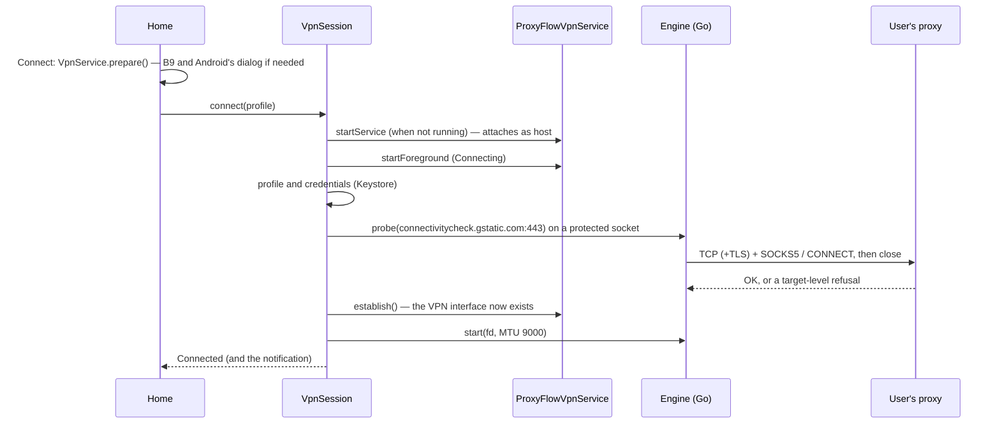

# M5 — VPN service integration

**Milestone:** M5 · **Decisions:** ADR-0010 (this milestone), ADR-0001–0005 (engine), ADR-0007 (foreground service type) · **Code:** `core/vpn/`, `feature/home/`, `app/src/androidTest/`

M5 puts the M4 engine behind Android's VPN interface. This document describes how the pieces fit, what each connection state means for the user's traffic, and how the milestone is tested; the acceptance report (`M5-acceptance-report.md`) holds the results.

## 1. Pieces

| Piece | Where | Role |
|---|---|---|
| `ConnectionController` | `core/data` | The screens' only view of the connection: `state` (a `StateFlow<ConnectionState>`), `consentIntent()`, `connect()`, `disconnect()`, `restart()`, `clearError()` |
| `VpnRuntime` | `core/vpn` | One per process (built by `AppContainer`): the state, the session, the controller; watches for the connected profile being deleted |
| `VpnSession` | `core/vpn` | The state machine. One event at a time on a serial dispatcher; owns the VPN interface's descriptor |
| `ProxyFlowVpnService` | `core/vpn` | Android's side: consent check, `Builder.establish()`, `protect()`, the foreground notification, revocation and Always-on starts. No logic of its own |
| `ProxyTunnelEngine` | `core/vpn` | The session's view of the engine (`ProxyEngine`): pre-flight probe, start on the interface, stop |
| `VpnNotifications` | `core/vpn` | The two channels and every notification |
| Home | `feature/home` | Boards B2, B3, B4, B5 (switching), B6b, B6d, the blocked layout, B9, H1 |



## 2. States and what they mean for traffic

"Held" means apps' traffic goes into the VPN interface and nothing reads it: nothing leaves the phone except to the proxy, and nothing reaches the proxy either.

| State | Interface | Engine | Apps' traffic | Home | Notification |
|---|---|---|---|---|---|
| Disconnected | none | stopped | normal network | B2 (or B6b / B6d / H1 with the last reason) | none (revocation: an alert) |
| Connecting | none | stopped (the check runs) | normal network — nothing switched over yet | B3 with its steps, Cancel | Connecting… with the step, Cancel |
| Connected | up | running | TCP through the proxy, by name | B4: timer, protection summary, Disconnect | Connected with timer, Disconnect |
| Reconnecting (switch or restart) | up | stopped | held | "Reconnecting to …", Stop | Reconnecting… traffic paused |
| Blocked (engine failed, or a reconnect's check failed) | up | stopped | held | blocked layout with the reason, Restart / Try again, Edit profile, Stop (confirmed) | Traffic blocked, Restart, Disconnect |

Transitions, all handled by `VpnSession`:

| Event | From | To |
|---|---|---|
| connect(p) | Disconnected | Connecting (the service starts if needed) |
| connect(p) for the same profile | Connecting, Reconnecting, Connected | unchanged (duplicate start) |
| connect(q) for another profile, Restart | Connected, Blocked | Reconnecting: the engine stops, the interface stays |
| check fails (proxy-level code, `INTERNAL`) | Connecting | Disconnected with the code (B6b) — nothing changed on the phone |
| check fails | Reconnecting | Blocked with the code |
| check passes, interface established, engine runs | Connecting, Reconnecting | Connected (a reconnect closes the old interface only now) |
| engine cannot start | Connecting | Disconnected (the new interface is closed again) |
| engine cannot start | Reconnecting | Blocked |
| `engine_failed` | Connected | Blocked (`ENGINE_STOPPED`) |
| no consent, or `establish()` refused | any | Disconnected (`VPN_PERMISSION_DENIED`, H1) |
| disconnect | any | Disconnected (no error) |
| revocation | any with an interface | Disconnected (`VPN_REVOKED`, B6d and an alert) |
| the connection's profile is deleted | any but Disconnected | Disconnected |
| the service is destroyed | any | Disconnected (`INTERNAL`) |

What goes through the VPN once connected is unchanged from M4 and the traffic support matrix (`docs/m1/02-traffic-support-matrix.md`): TCP over IPv4 and IPv6 through the proxy; DNS answered on the phone with fake addresses, so the proxy receives names and resolves them; UDP other than DNS refused; ICMP never answered; ProxyFlow's own connections (the engine's, the pre-flight check's) outside the VPN, both excluded and protected. Proxy failures after connecting (a proxy that dies, a password changed on the provider's side) are refused connection by connection, never sent around the proxy, but Home keeps showing Connected until M7's escalation rule.

## 3. Ownership and clean-up

- The session holds the interface's `ParcelFileDescriptor`; the engine reads the raw descriptor and never closes it. Every path out of a connection stops the engine first and closes the descriptor after (`VpnSessionTest.disconnectStopsTheEngineBeforeClosingTheInterfaceThenTheService`).
- A reconnect establishes the new interface before closing the old one, and starts the engine on the new one in between, so there is no moment without an interface.
- The service is started by the session when a connection needs it and stops itself with `stopSelfResult()`; Android keeps it bound while an interface exists.
- Credentials are read from the Keystore twice per connection (check, engine), turned into `EngineSecret` bytes at once and zeroed after use; they never become a `String`.
- The pre-flight check's coroutine is cancelled on disconnect; a native call already in progress finishes within its 15 s budget and its answer is dropped.

## 4. Permissions and Android rules

| Permission / rule | Why |
|---|---|
| `INTERNET` | The engine's and the pre-flight check's connections to the proxy |
| `FOREGROUND_SERVICE`, `FOREGROUND_SERVICE_SYSTEM_EXEMPTED` | The VPN runs as a foreground service; `systemExempted` on Android 14+ for VPN apps the user allowed (ADR-0007) |
| `POST_NOTIFICATIONS` | Android 13+: the status and problem notifications; optional |
| Service `exported="false"`, `BIND_VPN_SERVICE`, filter `android.net.VpnService` | Only Android binds it; the filter lets Android start it for Always-on VPN |
| Consent | `VpnService.prepare()` when the user taps Connect; B9 first; H1 on refusal |

## 5. How it is tested

| Level | What | Where |
|---|---|---|
| JVM | Every transition in §2 with a fake engine and a fake service: order of check, establish and engine start; Connected never before; no interface on failed checks; duplicate starts; switching without a gap; blocked states and Restart; revocation; consent refused; the service starting late, never, or refused; Always-on with and without a chosen profile; deleted profiles; 20 cycles with nothing left open | `core/vpn/src/test` |
| JVM (Robolectric) | Home in every state, the explainer, H1, the stop confirmation; the ViewModel's consent flow and which profile Home shows; the merged manifest (permissions, the service declaration); screenshots of each state in both themes | `feature/home/src/test`, `app/src/test` |
| Emulators (API 29, 34, 35, 36) | The real app, service and engine against Dante (SOCKS5) and Squid (HTTP CONNECT) with sign-in on the CI runner: shell traffic to a destination reachable only by name through a proxy; Android's consent dialog refused and allowed; wrong passwords, a closed port and a silent proxy that never connect (Android never sees a VPN network); a switch; revocation; an engine failure that holds traffic until Restart; repeated starts and ten connect/disconnect cycles leaving no interface, service, job or socket; nothing listening; the lock-screen version of the notification | `app/src/androidTest/kotlin/app/proxyflow/e2e` |
| CI evidence | Every line the tests sent arrived exactly once and through a proxy (the destination's connections match the proxies' tunnels), no line sent while traffic was held arrived, Squid was asked for the destination by name, packet captures of the emulator's uplink show no packet to the destination and no DNS query for its name, and no test password is in logcat | `scripts/m5_evidence.py` |

### Running the device tests yourself

The end-to-end tests need the proxies and the destination that CI sets up (`scripts/m5_device_env.sh`, for an Ubuntu host whose loopback the emulator reaches as `10.0.2.2`), and the file it writes on the emulator:

```bash
bash scripts/m5_device_env.sh                       # Dante, Squid, destination (sudo; Ubuntu)
adb push /tmp/pf/e2e.properties /data/local/tmp/proxyflow-e2e.properties
./gradlew :app:connectedDebugAndroidTest            # without the file, the end-to-end tests are skipped
```

## 6. Known limits of M5

| Limit | Planned |
|---|---|
| Network changes, reconnect with back-off, offline state, the escalation rule (a proxy that dies after connecting) | M7 |
| Traffic counters, active connections and the session log on B4 | M7 |
| Kill switch guidance, Always-on lockdown detection, H2 (another app is Always-on) | M8 |
| Picking another profile or editing the active one while connected (the controller already switches); Quick Settings tile; onboarding's notification step | M9 |
| "Test connection" in the profile form still says testing isn't available (D6 decides what it contacts) | D6, M9 |
| MTU 9000 measured on phones, 1500 as fallback | M10 |
