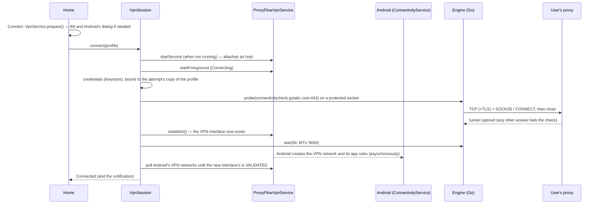

# M5 — VPN service integration

**Milestone:** M5 · **Decisions:** ADR-0010 (this milestone), ADR-0001–0005 (engine), ADR-0007 (foreground service type) · **Code:** `core/vpn/`, `feature/home/`, `feature/profiles/` (deleting the profile in use), `app/src/androidTest/`

M5 puts the M4 engine behind Android's VPN interface. This document describes how the pieces fit, what each connection state means for the user's traffic, and how the milestone is tested; the acceptance report (`M5-acceptance-report.md`) holds the results.

## 1. Pieces

| Piece | Where | Role |
|---|---|---|
| `ConnectionController` | `core/data` | The screens' only view of the connection: `state` (a `StateFlow<ConnectionState>`), `consentIntent()`, `connect()`, `disconnect()`, `restart()`, `clearError()` |
| `VpnRuntime` | `core/vpn` | One per process (built by `AppContainer`): the state, the session, the controller, the lifecycle log; watches for the connected profile being deleted |
| `VpnSession` | `core/vpn` | The state machine. One event at a time on a serial dispatcher; owns the VPN interface's descriptor |
| `ProxyFlowVpnService` | `core/vpn` | Android's side: consent check, `Builder.establish()`, `protect()`, Android's view of its VPN network, the foreground notification, revocation and Always-on starts. No connection logic of its own |
| `ProxyTunnelEngine` | `core/vpn` | The session's view of the engine (`ProxyEngine`): pre-flight probe, start on the interface, stop |
| `ShutdownGuard` | `core/vpn` | Cuts a cancelled pre-flight check short by shutting down duplicates of its sockets |
| `VpnNotifications` | `core/vpn` | The two channels and every notification |
| `VpnLog` | `core/vpn` | The lifecycle (tag `ProxyFlowVpn`, and the last 200 entries in memory); profile ids only, no credentials, server names or payloads |
| Home | `feature/home` | Boards B2, B3, B4, B5 (switching), B6b, B6d, the blocked layout, B9, H1 |
| Profiles | `feature/profiles` | "Disconnect and delete" for the profile a connection uses (J11) |



## 2. States and what they mean for traffic

"Held" means apps' traffic goes into the VPN interface and nothing reads it: nothing leaves the phone except to the proxy, and nothing reaches the proxy either. What was held is dropped before the next engine starts on the interface, never delivered later; apps send again.

| State | Interface | Engine | Apps' traffic | Home | Notification |
|---|---|---|---|---|---|
| Disconnected | none | stopped | normal network | B2 (or B6b / B6d / H1 with the last reason) | none (revocation: an alert) |
| Connecting | none, then up while Android moves apps over | stopped, then running | normal network until Android routes apps into the interface | B3 with its steps, Cancel | Connecting… with the step, Cancel |
| Connected | up, Android routes apps into it | running | TCP through the proxy, by name | B4: timer, protection summary, Disconnect | Connected with timer, Disconnect |
| Reconnecting (switch or restart) | up, the same one | stopped, then the next engine runs on it | held | "Reconnecting to …", Stop | Reconnecting… traffic paused |
| Blocked (engine failed, a reconnect failed, the profile was deleted) | up, the same one | stopped | held | blocked layout with the reason, Restart / Try again, Edit profile, Stop (confirmed); only Stop for `PROFILE_DELETED` | Traffic blocked with the reason, Restart, Disconnect; only Disconnect for `PROFILE_DELETED` |

Transitions, all handled by `VpnSession`:

| Event | From | To |
|---|---|---|
| connect(p) | Disconnected | Connecting (the service starts if needed) |
| connect(p) for the same profile | Connecting, Reconnecting, Connected | unchanged (duplicate start) |
| connect(q) for a profile that no longer exists | any | unchanged while a connection runs; Blocked stays Blocked (`PROFILE_DELETED`) for its own profile |
| connect(q) for another profile, Restart | Connected, Blocked | Reconnecting: the engine stops, the interface stays |
| the profile's server, protocol, TLS or sign-in changed during the attempt | Connecting, Reconnecting | the same state, checking the new settings from the start |
| check fails: anything but an opened tunnel (proxy-level codes, refusals, general failures, an unreachable destination), `INTERNAL` | Connecting | Disconnected with the code (B6b) — nothing changed on the phone |
| check fails | Reconnecting | Blocked with the code |
| check passes; a first connect establishes the interface; the engine runs on it | Connecting, Reconnecting | still Connecting / Reconnecting (step: starting protection) until Android routes apps into the interface |
| Android routes apps into the interface (at once on a reconnect) | Connecting, Reconnecting | Connected |
| the engine cannot start, or Android does not route within 10 s | Connecting | Disconnected (the interface is closed again) |
| the engine cannot start, or Android no longer routes the interface | Reconnecting | Blocked on the interface |
| `engine_failed` | Connected | Blocked (`ENGINE_STOPPED`) |
| `engine_failed` | Connecting (waiting for Android) | Disconnected (`ENGINE_STOPPED`) |
| no consent, or `establish()` refused (Android has removed any VPN) | any | Disconnected (`VPN_PERMISSION_DENIED`, H1) |
| disconnect | any | Disconnected (no error) |
| revocation | any with an interface | Disconnected (`VPN_REVOKED`, B6d and an alert) |
| the connection's profile is deleted ("Disconnect and delete" disconnects first), also during the re-check of an edit | Connecting | Disconnected |
| the connection's profile disappears otherwise | Connected, Reconnecting, Blocked | Blocked (`PROFILE_DELETED`): the engine stops, traffic is held until the user stops |
| the service is destroyed | any | Disconnected (`INTERNAL`) |
| an exception nothing expected in the check or the routing wait | Connecting / Reconnecting | as a failed check: Disconnected / Blocked (`INTERNAL`) |

What goes through the VPN once connected is unchanged from M4 and the traffic support matrix (`docs/m1/02-traffic-support-matrix.md`): TCP over IPv4 and IPv6 through the proxy; DNS answered on the phone with fake addresses, so the proxy receives names and resolves them; UDP other than DNS refused; ICMP never answered; ProxyFlow's own connections (the engine's, the pre-flight check's) outside the VPN, both excluded and protected. Proxy failures after connecting (a proxy that dies, a password changed on the provider's side) are refused connection by connection, never sent around the proxy, but Home keeps showing Connected until M7's escalation rule.

## 3. Ownership and clean-up

- The session holds the interface's `ParcelFileDescriptor`; the engine reads the raw descriptor and never closes it. Every path out of a connection stops the engine first and closes the descriptor after (`VpnSessionTest.disconnectStopsTheEngineBeforeClosingTheInterfaceThenTheService`).
- One interface per connection. A reconnect stops the engine and starts the next one on the same interface, which holds apps' traffic in between. Creating a new interface instead would leak: inside `establish()` Android brings the old interface down at once and moves the VPN's routes to the new one afterwards, and meanwhile its fall-through rule sends apps' traffic to the normal network. A reconnect that fails keeps the interface.
- "Connected" is Android's view, not only the session's: a VPN network leading into the session's interface (its name from `/proc/self/fdinfo`) that Android reports VALIDATED. `ConnectivityManager.getAllNetworks()` is polled, because network callbacks never report a VPN that excludes the caller.
- The service is started by the session when a connection needs it and stops itself with `stopSelfResult()`; Android keeps it bound while an interface exists. Its status notification: the first update at once, then at least 300 ms apart with the last state always shown; a late stop never removes a newer connection's notification.
- Credentials are read from the Keystore twice per connection (check, engine), each time with the stored profile checked against the attempt's copy, turned into `EngineSecret` bytes at once and zeroed after use; they never become a `String`. The check's read happens inside the check's coroutine, so a check cancelled before it ran decrypts nothing.
- A cancelled pre-flight check ends at once: `ShutdownGuard` shuts down duplicates of the sockets it protected, so the engine's blocking call returns; the duplicates are closed when it has. `activeJobs()` counts the check until then.

## 4. Permissions and Android rules

| Permission / rule | Why |
|---|---|
| `INTERNET` | The engine's and the pre-flight check's connections to the proxy |
| `ACCESS_NETWORK_STATE` | Android's view of the VPN network: Connected waits until Android routes apps into the new interface |
| `FOREGROUND_SERVICE`, `FOREGROUND_SERVICE_SYSTEM_EXEMPTED` | The VPN runs as a foreground service; `systemExempted` on Android 14+ for VPN apps the user allowed (ADR-0007) |
| `POST_NOTIFICATIONS` | Android 13+: the status and problem notifications; optional |
| Service `exported="false"`, `BIND_VPN_SERVICE`, filter `android.net.VpnService` | Only Android binds it; the filter lets Android start it for Always-on VPN |
| Consent | `VpnService.prepare()` when the user taps Connect; B9 first; H1 on refusal |

## 5. How it is tested

| Level | What | Where |
|---|---|---|
| JVM | Every transition in §2 with a fake engine and a fake service: order of check, establish, engine start and Android's routing; Connected never before Android routes, and a fresh interface Android never routes taken down again; only an opened tunnel passes the check; no interface on failed checks; switches and restarts on the one interface; credentials bound to the attempt's copy of the profile (an edit during the check checks the new server first; a deletion during that re-check ends the attempt); a check cancelled before it ran decrypts nothing, one cancelled while it ran is cut short (also on a single thread) and counted until it returns; exceptions in the check and in reading Android's networks fail the attempt instead of the app; engine start failures of every kind; duplicate starts; blocked states and Restart; revocation; consent refused, and gone during a switch; the service starting late, never, or refused; Always-on with and without a chosen profile; deleted profiles while connected and while connecting; a connect for a missing profile leaving the connection alone; 20 cycles with nothing left open | `core/vpn/src/test` |
| JVM | What the status notification says and offers in each state: Cancel while connecting, Disconnect when connected or reconnecting, Restart and Disconnect when blocked, only Disconnect for a deleted profile | `core/vpn/src/test` (`StatusContentTest`) |
| JVM | Credentials for a connection only while the stored profile still reaches the same proxy | `core/data/src/test` (`ProfileRepositoryTest`) |
| JVM (Robolectric) | Home in every state, the explainer, H1, the stop confirmation, the new failure messages, the blocked layout of a deleted profile; the ViewModel's consent flow and which profile Home shows (the connection's own copy while it runs); "Disconnect and delete" in the profile list; the merged manifest (permissions, the service declaration); screenshots of each state in both themes | `feature/home/src/test`, `feature/profiles/src/test`, `app/src/test` |
| Emulators (API 29, 34, 35, 36) | The real app, service and engine against Dante (SOCKS5) and Squid (HTTP CONNECT) with sign-in on the CI runner: shell traffic to a destination reachable only by name through a proxy; Android's VPN network ready and leading into the session's interface whenever the app says Connected; Android's consent dialog refused and allowed; wrong passwords, a closed port and a silent proxy that never connect and never establish an interface; a switch to a silent proxy (traffic sent while it runs and after it fails is held) and on to a working one, on the same interface; revocation; an engine failure that holds traffic until Restart; a cancelled check cut short; repeated starts and ten connect/disconnect cycles leaving no interface, service, job or socket; nothing listening; the lock-screen version of the notification. A failed wait reports the state, interfaces, Android's VPN networks, the lifecycle log and Android's record of the service | `app/src/androidTest/kotlin/app/proxyflow/e2e` |
| CI evidence | Before the tests, the phone's uplink must reach the runner (mobile data, switched off and on once if it doesn't, Wi-Fi as the last resort; the evidence names the uplink used). Afterwards: every line the tests sent arrived exactly once and through a proxy (the destination's connections match the proxies' tunnels), no line sent while traffic was held arrived, Squid was asked for the destination by name, packet captures of the emulator's uplink show no packet to the destination and no DNS query for its name, no test password is in logcat; the end of the lifecycle log as a notice | `scripts/m5_evidence.py` |

### Running the device tests yourself

The end-to-end tests need the proxies and the destination that CI sets up (`scripts/m5_device_env.sh`, for an Ubuntu host whose loopback the emulator reaches as `10.0.2.2`, with Internet access for the pre-flight target), and the file it writes on the emulator:

```bash
bash scripts/m5_device_env.sh                       # Dante, Squid, destination (sudo; Ubuntu)
adb push /tmp/pf/e2e.properties /data/local/tmp/proxyflow-e2e.properties
./gradlew :app:connectedDebugAndroidTest            # without the file, the end-to-end tests are skipped
```

## 6. Known limits of M5

| Limit | Planned |
|---|---|
| Network changes, reconnect with back-off, offline state, the escalation rule (a proxy that dies after connecting) | M7 |
| Traffic counters, active connections and the session log on B4 | M7 |
| Kill switch guidance, Always-on lockdown detection, H2 (another app is Always-on) | M8 |
| Picking another profile while connected (the controller already switches); edits to the connected profile apply at the next connect, and Home shows the settings the connection runs meanwhile; Quick Settings tile; onboarding's notification step | M9 |
| "Test connection" in the profile form still says testing isn't available (D6 decides what it contacts) | D6, M9 |
| MTU 9000 measured on phones, 1500 as fallback | M10 |
